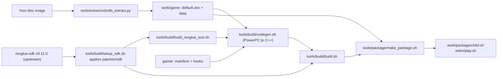

# Child of Eden — static recompilation for Linux

> **Current stage: bug hunting — help wanted.** The game boots and is playable, and the first archive (Matrix) now
> seems to play without known bugs on a ROG Ally. The other archives still have problems that only show up when a
> person plays them (for example, in Evolution the player can take hits from things that are not visible; under
> investigation). If you build this with your own copy of the game and find a bug, please
> [open an issue](../../issues) with the archive, what you saw, your GPU/driver and the `logs/` file of that session —
> or send a pull request. Do not attach game files, recompiled binaries or long gameplay captures.

An unofficial static recompilation of **Child of Eden** (Xbox 360, 2011) into a native Linux x86_64 executable.
The game's PowerPC code is translated to C++ with [rexglue-sdk](https://github.com/rexglue/rexglue-sdk) and built
against its Xenia-derived runtime, which renders with Vulkan. No emulator runs at play time.

**This repository contains no game code and no game data.** It holds only what we wrote: build scripts, patches to
the open-source runtime, a hook file, a launcher, test tooling and documentation. To build anything playable you
need **your own legally obtained copy of the game** (an Xbox 360 disc image). Nothing here downloads the game, and
the output of the build — the recompiled executable and the package around it — contains game code and data and
**must not be redistributed**. There are no binary releases, for the same reason.

This project is not affiliated with or endorsed by Q Entertainment, Ubisoft or Microsoft.

## Status

Measured on the development machines (an x86_64 Linux PC with a Radeon RX 9070 XT, and a ROG Ally running CachyOS):

- Boots, renders, plays audio, saves, and is playable with a controller at 60 fps (1280x720 internal; `--scale=2`
  renders at 2560x1440).
- All six archives (Matrix, Evolution, Beauty, Passion, Journey, Hope) have been completed on the build machine by
  the test bot **with debug cheats** (invincibility and auto-aim). No level has been verified end to end by a person
  without cheats.
- Playtested on a ROG Ally. A fix for 30 fps drops on battery was verified there.
- Controller mode only. Kinect is not supported in the playable package (Kinect imports are stubs).
- In-game settings menu (hold START for about a second) in English, Spanish, French, German, Italian, Portuguese
  and Japanese; the translations have not been reviewed by native speakers.
- Gyro aiming is implemented but was only tested with a virtual controller.
- **VR is an experiment** (`docs/analysis/vr-*.md`): OpenXR output and streaming to a Meta Quest 2 through WiVRn
  were exercised only against Monado's simulated headset, never on a physical headset.

Only the "USA, Europe" disc release was used (hashes in [docs/FEASIBILITY.md](docs/FEASIBILITY.md)). Other
releases are untested and the function addresses in `game/` may not match them.

Known problems and design decisions are in [docs/ARCHITECTURE.md](docs/ARCHITECTURE.md).

## How it works



The generated C++ calls the SDK's implementations of the Xbox 360 kernel, XAM, audio and input. The game talks to
the GPU through its command ring buffer and the SDK emulates the Xenos command processor on Vulkan, translating
shaders at run time.

## Build

Requirements: Linux x86_64, Docker (or Podman with `ENGINE=podman`, untested), about 8 GB of free RAM, roughly
10 GB of disk, git and python3. Everything is compiled inside containers; nothing is installed on the host.
All generated files go to `work/` (git-ignored; set `EDEN_WORK` to put them elsewhere).

```bash
containers/build_images.sh                                         # build and test images (Ubuntu 26.04, clang 21)
python3 -I tools/extract/xdvdfs_extract.py /path/to/game.iso work/game   # your own disc image
tools/build/setup_sdk.sh                                           # fetch rexglue-sdk v0.11.0, apply patches/sdk
tools/build/build_rexglue_tool.sh                                  # the codegen tool
mkdir -p work/project && cp -r game/. work/project/                # manifest + hook sources
tools/build/codegen.sh                                             # PowerPC -> C++ (about a minute and a half)
tools/build/build.sh                                               # compile and link (the long step)
tools/package/make_package.sh                                      # assemble work/package/child-of-eden
```

## Play

```bash
work/package/child-of-eden/play.sh            # fullscreen, controller
work/package/child-of-eden/play.sh --windowed --keyboard
```

The package runs on any Linux x86_64 system with Vulkan and a glibc at least as new as the build image's
(2.43 at the time of writing); `play.sh` checks this. Options, controls and the in-game settings menu are described
in [tools/package/README-package.md](tools/package/README-package.md), which is also copied into the package.
To move the package to a handheld, copy the whole directory, or see `tools/handheld/`.

## Test without a display

`tools/test/run.sh <N> <actions...>` starts the game in headless gamescope inside a container, sends timed key
presses, takes screenshots and can drive a bot. It needs a Vulkan GPU on the host. Example, a bot run of the first
level with the debug cheats:

```bash
EDEN_INVINCIBLE=1 EDEN_AUTOAIM=1 BOT_SHOT=5 tools/test/run.sh 1 k33:Return k40:l k46:space f62 b72-600
```

The debug environment variables are listed in [docs/DEBUG-SWITCHES.md](docs/DEBUG-SWITCHES.md).

## Repository layout

| Path | Contents |
|---|---|
| `game/` | Codegen manifest, CMake project and `src/eden_hooks.cpp` (our hooks: bot cheats, D3D wait, VR experiments) |
| `patches/sdk/` | Our changes to rexglue-sdk v0.11.0, as a patch series (see [patches/README.md](patches/README.md)) |
| `patches/gamescope/` | A gamescope fix needed to record video through PipeWire |
| `tools/extract`, `tools/analysis` | Disc extraction and static-analysis helpers for the executable |
| `tools/build`, `tools/package` | SDK setup, codegen, build, packaging and the `play.sh` launcher |
| `tools/test`, `tools/profile` | Headless test harness, bot actions, profiling and power measurement |
| `tools/handheld` | Updating and testing an install on a handheld over ssh |
| `tools/vr` | Experimental OpenXR / WiVRn scripts |
| `containers/` | Dockerfiles for the build, test, capture and VR images |
| `docs/` | Architecture, feasibility study, analyses and the full development log |
| `VERSIONS.md` | Pinned upstream sources |

## Documentation

- [docs/ARCHITECTURE.md](docs/ARCHITECTURE.md) — how the pieces fit, design decisions, known problems.
- [docs/FEASIBILITY.md](docs/FEASIBILITY.md) — the original feasibility study (engine, middleware, imports, tool comparison).
- [docs/analysis/](docs/analysis/) — dated investigations: exception tables, thread exit, GPU startup, XMA audio, VR stages.
- [docs/DEVLOG.md](docs/DEVLOG.md) — the complete engineering log, including what did not work.

## License and credits

Our own scripts, tools, hooks and documentation are under the MIT license (see [LICENSE](LICENSE)). The files in
`patches/sdk/` are modifications of rexglue-sdk and are offered under its BSD-3-Clause license;
`patches/gamescope/` follows gamescope's license.

Built on [rexglue-sdk](https://github.com/rexglue/rexglue-sdk) and, through it, on
[Xenia](https://github.com/xenia-project/xenia). Early measurements used
[XenonRecomp](https://github.com/hedge-dev/XenonRecomp). VR experiments use Monado and WiVRn.

Child of Eden is © Q Entertainment / Ubisoft. All trademarks belong to their owners.
