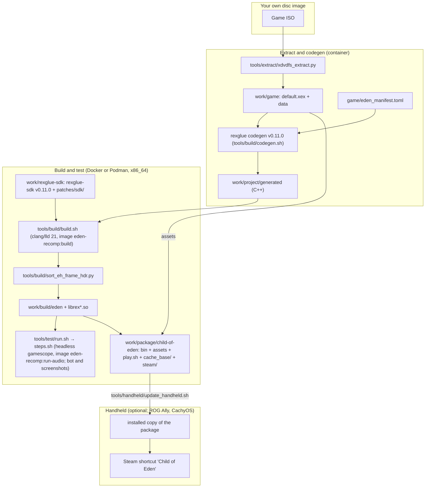
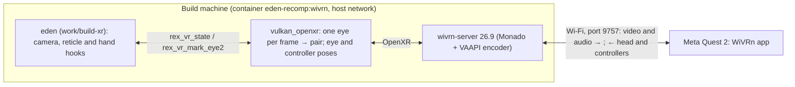

# Eden-Recomp — Architecture

Last updated 2026-11-25 (public English release: single-machine build flow, regenerated SDK patch series).

## What it is and why it exists
Static recompilation of **Child of Eden (Xbox 360)** to a native Linux executable, to play it on a **ROG Ally**
(CachyOS). You need your own legally obtained copy of the game. This repository contains no game code or data
(executable, data, translated code, screenshots); a package built locally with these tools does contain game code and
data and must not be redistributed.

It started on 2026-11-19 as a feasibility study (`docs/FEASIBILITY.md`: feasible). Today **the game boots, renders,
plays audio, saves and is playable with a controller** at 60 fps, and it has been installed on a ROG Ally with a Steam
shortcut.

Game facts (measured, see `docs/FEASIBILITY.md`): Q Entertainment's own engine (not Unreal), Lua 5.1.2, statically
linked D3D9 with HLSL compiled at run time, WMV video, 218 imports, 10.4 MB of PowerPC code (46,579 functions
according to rexglue).

## Architecture
The pipeline is: extract → codegen → patch SDK → build → test headless → package → (optional) copy to a handheld.

- The generated C++ calls the SDK's `__imp__<Export>` functions (kernel, XAM, audio, input). The game talks to the GPU
  through its ring buffer and the SDK emulates the Xenos command processor on top of **Vulkan**; shaders are translated
  on the fly (XenosRecomp is not used).
- The runtime is split into libraries: `librexkernel`, `librexxam`, `librexgpu-xenos-vulkan`, `librexapu-sdl3`,
  `librexhid-sdl3`, `librexui-sdl3`, `librexfilesystem`, `librexppc`, etc., plus `libSDL3`.

Original development setup: developed with codegen on an ARM Mac and builds/tests on an x86_64 Linux PC with an
RX 9070 XT; played on a ROG Ally running CachyOS. The public scripts assume a single Linux x86_64 machine with Docker
or Podman; wherever this document says "the build machine", it means that x86_64 PC.

## How to use it

### Play (handheld or any Linux x86_64 with Vulkan and glibc ≥ 2.43)
`<package dir>/play.sh [options]`, or a Steam shortcut pointing at `play.sh`.

| Option | Effect |
|---|---|
| `--windowed` | Windowed instead of fullscreen |
| `--keyboard` | Keyboard as the controller (`Return` START, `space` A, `BackSpace` B, `l` X) |
| `--fps=N` | Frame limit (the game is natively 60; 30 does not put it in slow motion) |
| `--scale=N` | Internal resolution xN (`2` = real 1440p) |
| `--hz=120` | 120 real frames on a 120 Hz display. **Experimental** |
| `--fxaa[=extreme]` | The runtime's FXAA / extreme FXAA |
| `--gyro[=N]`, `--gyro-invert-x/y`, `--gyro-roll` | Controller gyro added to the stick (our own patch) |

In game: **holding START for ~1 s** opens a short menu (language, frames per second, image quality, anti-aliasing,
volume, gyro, frame counter, advanced options, quit). It comes up in English by default; the "Language" row switches
it to Spanish, French, German, Italian, Portuguese or Japanese (`ui.language` in `bin/eden.toml`; Japanese needs a
Noto Sans CJK font installed on the system); the D-pad moves and changes, **A** selects, a tap of **START** closes;
changes are saved automatically to `bin/eden.toml`. **F4** (keyboard) opens the full technical menu; **F3** the frame
counter. Compiled shaders are stored in `cache/`; if the package ships `cache_base/` (shaders precompiled with the
bot), `play.sh` adds whatever is missing to `cache/`, without removing anything. `play.sh` passes
`--gpu.xenos.readback_memexport=true --gpu.xenos.readback_memexport_lazy=true` (the game reads back on the CPU data
it computes on the GPU; the stock synchronous readback dropped to 30 and 15 fps for stretches of several minutes, and
with no readback at all gameplay breaks, see the design notes) and `--gpu.xenos.clear_memory_page_state=false` (with the factory value the runtime re-uploaded
47 MB of unchanged game memory per frame at the start of the second level, which meant 30 fps on a handheld on
battery). The game also has its own "Options" menu (vibration, brightness, volume, inverted controls). The save
is stored in `user/…/eden/eden_game.dat` next to the binary.

### Regenerate and build
0. **Once:** `containers/build_images.sh`, extract your disc image to `work/game/`
   (`tools/extract/xdvdfs_extract.py`), `tools/build/setup_sdk.sh` (fetches rexglue-sdk v0.11.0 and applies
   `patches/sdk/`), `tools/build/build_rexglue_tool.sh` (the codegen tool), and copy `game/` to `work/project/`.
1. **Codegen:** `tools/build/codegen.sh` runs `rexglue codegen eden_manifest.toml` in a container on the project in
   `work/project/` (~47 s on the ARM Mac, ~87 s in the x86_64 build container). The split of functions across
   `eden_recomp.N.cpp` files differs between the two hosts; the set of functions is the same.
2. **Build:** run `tools/build/build.sh` (image `eden-recomp:build`; the original setup ran it with `-m 7g --cpus 6`).
   In the original two-machine setup the generated C++ was first copied to the build machine with
   `rsync -a --checksum`. The last step runs `sort_eh_frame_hdr.py`; without it every `throw` ends in `std::terminate`.
3. **Test headless:** `tools/test/run.sh <N> <actions>`: headless gamescope + a real GPU.
   Actions: `f<sec>` screenshot, `k<sec>:<key>` key press, `d`/`u` hold/release, `b<start>-<end>` bot. Example up to the
   Matrix level with an existing save: `run.sh 15 k33:Return k40:l k46:space f62 f130`. Variables: `AUDIO=pulseaudio`
   (records `audio<N>.wav`), `VIDEO=1` + `tools/test/make_video.sh <N>`, `GS_W`/`GS_H`, `GS_EXTRA`, `EDEN_EXTRA`,
   `DOCKER_EXTRA`.
   **Bot that completes levels:** `EDEN_INVINCIBLE=1 EDEN_AUTOAIM=1 BOT_SHOT=5
   EDEN_EXTRA="--app.cache_root=/b/cache_merged" bash tools/test/run.sh <N> k33:Return k40:l k46:space f62
   b72-<end>`. In Archive Select (seconds 42–46) each `k<sec>:d` moves one level to the right (Matrix 0, Evolution 1,
   Beauty 2, Passion 3, Journey 4, Hope 5). `tools/test/contact_sheet.sh <N> <from_s> [n]` builds a contact sheet of
   run N.
   One run at a time; long ones in the background, watching that `work/build/run<N>.log` does not grow past 500 MB.
4. **Package:** `tools/package/make_package.sh` assembles `work/package/child-of-eden/` (binaries, `play.sh`, the
   game data hard-linked from `work/game/`, and `cache_base/` if `work/cache_base/` exists).
5. **Update a handheld:** `HANDHELD=user@host tools/handheld/update_handheld.sh [--dry-run]`. It copies `bin/`,
   `play.sh` and `cache_base/` from the package, backs up `bin/` as `bin.prev-<date>`, does not touch `user/` (save),
   `cache/`, `logs/` or `bin/eden.toml`, and refuses to run if the game is open. Install from scratch:
   `tar -C work/package -cf - child-of-eden | ssh "$HANDHELD" 'bash -c "tar -C ~/Apps -xf -"'` (the handheld used in
   development has fish as its shell: remote commands go through `bash -c` or `bash -s`).

### Play in VR with a Meta Quest 2 (experimental, untested on the headset)
The game does not run on the headset: it runs on the build machine and is streamed over Wi-Fi with WiVRn.
1. On the Quest 2, install the **WiVRn 26.9** app (Meta Store). Same network as the build machine.
2. On the build machine, `bash tools/vr/quest.sh` (`--dry-run` to see what it will do). It opens port 9757 to the LAN
   only while it runs.
3. In the app, connect to the build machine's LAN address and, the first time, type the PIN the script shows. The game
   starts by itself.
4. Menus: point with the right controller and hold for ≈ 3 s. Level: point and right trigger; left trigger held =
   burst fire; both grips = Euphoria. Settings: `QUEST_HZ`, `QUEST_SCALE`, `QUEST_HEAD=0`.
Without a headset it is tested with Monado's remote device: `XR_REMOTE="H1:0,0 D28:18.91,14.24 …" EDEN_VR_HEAD=1
EDEN_VR_CONTROLLERS=1 EDEN_VR_FAKENUI=1 EDEN_VR_SKELETON=1 EDEN_VR_PERIOD=1 bash tools/vr/run_xr.sh <N> f100`.

## Where each piece lives
| Piece | Path |
|---|---|
| Game project: hooks (`src/eden_hooks.cpp`), `src/main.cpp`, CMake files, codegen manifest (`eden_manifest.toml`) | `game/` |
| Our patches to the runtime (rexglue-sdk v0.11.0) | `patches/sdk/` |
| gamescope patch for PipeWire capture | `patches/gamescope/` |
| Disc extraction and XEX inspection | `tools/extract/` |
| XEX analysis (cross-references, call tree, disassembly) | `tools/analysis/` |
| SDK setup (`setup_sdk.sh`), codegen tool and codegen, build, `.eh_frame_hdr` post-step, XR and WiVRn builds | `tools/build/` |
| Headless test harness: runs, step script, bot actions, contact sheets, video | `tools/test/` |
| Profiling and power measurement | `tools/profile/` |
| Packaging (`make_package.sh`), launcher (`play.sh`), package README, shader cache merge, Steam art | `tools/package/` |
| Handheld update, remote test and stack sampling | `tools/handheld/` |
| VR: OpenXR runs, Monado remote device, Quest launcher | `tools/vr/` |
| Container definitions: `eden-recomp:build` (build), `:build-xr` (build with OpenXR), `:run` (+gamescope), `:run-audio` (+pulseaudio), `:run-ffmpeg` (+ffmpeg), `:monado`, `:wivrn` (WiVRn), `:capture` (PipeWire/GStreamer), `:capture-gamescope` (the same with the patched gamescope that makes video capture work); ARM Mac experiments in `containers/experiments/` | `containers/` |
| Documentation; analyses in `docs/analysis/` (`threadstop`, `thread-exit`, `gpu-startup`, `xma-audio-crash`, `vr-feasibility`, `vr-stage0`…`vr-stage4`) | `docs/` |
| Pinned upstream versions | `VERSIONS.md` |
| Extracted disc contents (`default.xex` + data) (git-ignored) | `work/game/` |
| rexglue-sdk v0.11.0 checkout with `patches/sdk/*.patch` applied (git-ignored) | `work/rexglue-sdk/` |
| Codegen project: `eden_manifest.toml`, `generated/`, `src/` copied from `game/` (git-ignored) | `work/project/` |
| Build output (`eden`, `librex*.so`) and run logs; XR build (git-ignored) | `work/build/`, `work/build-xr/` |
| Screenshots from test runs (git-ignored) | `work/shots/` |
| Playable package (git-ignored) | `work/package/child-of-eden/` |

`work/` can be relocated with `EDEN_WORK`.

What the SDK patches in `patches/sdk/` do: the controller settings menu and its languages (plus a scripted virtual
controller used to test it); gyro aiming; XMA audio fixes (including invalid XMA packets) and audio diagnostics; GPU
memory and vertex-stream fixes (invalid reserved memory seen by the GPU, unassigned vertex streams); diagnostics and
robustness fixes (wait diagnostics, a null string buffer, disassembly of a shader with an unnamed vertex format); and
the OpenXR output for the experimental VR fork.

Experimental VR fork: hooks in `game/src/eden_hooks.cpp`; OpenXR output in the SDK patches; build with
`tools/build/build_xr.sh` into `work/build-xr/`; WiVRn server built with `tools/build/build_wivrn.sh` (image
`eden-recomp:wivrn`); Quest launcher `tools/vr/quest.sh`.

### Debug switches for the bot (off unless their variable is set)
The full list, derived from the code, is in `docs/DEBUG-SWITCHES.md`.
- In `game/src/eden_hooks.cpp`: `EDEN_INVINCIBLE`; `EDEN_AUTOAIM` (moves the reticle onto the target and requests the
  left stick so the view follows it); `EDEN_DAMAGE=N` (multiplies damage to targets with more than 1000 health;
  Journey needs 20); `EDEN_VIDEO_TRACE=1` (trace of the WMV player); `EDEN_AIM_TEST` (camera diagnostics).
- GPU diagnostics in the SDK patches: `EDEN_GPU_CLEAR`, `EDEN_GPU_WATCH` (memory patch) and `EDEN_GPU_DRAWS` (dumps the
  last 8192 draws if the GPU device is lost), `EDEN_GPU_SKIP="hash,…"` (does not draw anything that uses that shader),
  `EDEN_GPU_VFETCH=hash` (prints the vertex fetch constants).

## Design decisions
- **rexglue-sdk instead of XenonRecomp + our own runtime:** it translates the opcodes XenonRecomp leaves out, detects
  this binary's jump tables (XenonAnalyse detected 0) and ships the complete runtime (derived from Xenia, BSD-3).
- **No XenosRecomp:** the game compiles HLSL at run time; the SDK translates the Xenos microcode on the fly.
- **Controller mode, not Kinect** (decided 2026-11-19). The Kinect imports remain stubs.
- **Target is Linux (CachyOS), not Windows.** The build is x86_64 and is done on the build machine; in the original
  setup the ARM Mac (capped at 6 GB) only did the codegen.
- **`.eh_frame_hdr` post-step:** the SDK expects lld 20; with lld 21 and `-mcmodel=large` the table ends up unsorted and
  exceptions are not caught. It is re-sorted after linking instead of downgrading (lld 20 was not tested).
- **Gyro as a velocity added to the stick:** the game's stick drives reticle velocity, so the angular velocity is added
  directly, without integrating an angle.
- **Controller settings menu in the UI layer, not in the driver:** the UI reads the controller with `GetRawState`
  (ignores the lock) and reuses the UI lock the runtime already had so the game does not receive buttons while the menu
  is open.
- **Vsync always on:** removing it throws the tutorials out of place. 120 frames are achieved by declaring 120 Hz to
  the game.
- **No temporal FSR or frame generation:** the game does not provide motion vectors; instead, internal resolution x2
  and FXAA.
- **VR by streaming (WiVRn), not native on the Quest:** the headset does not run x86 and its GPU would be the
  bottleneck; the build machine has the GPU and Linux. ALVR was discarded because it requires SteamVR.
- **VR: one eye per frame and two layers.** The game walks its task tree once per frame, so each frame is one eye. In a
  level the pair goes out as a projection layer with head tracking; in menus, as a floating screen, because the 2D text
  does not go through the camera.
- **Game ↔ SDK link through `dlsym`:** the GPU library is loaded with `dlopen`; a weak symbol does not get resolved.
- **Lazy memexport readback (`readback_memexport_lazy`, patch 0006):** the game computes data on the GPU (memexport)
  and reads it back on the CPU. The stock readback waits for the GPU on every draw (30 and 15 fps stretches). Turning
  the readback off fixed the frame rate and looked harmless with the bot, but it broke gameplay: in Evolution the
  whale's projectiles were born at the world origin instead of on the whale, so they reached the player from behind or
  from outside the view ("hit by things I cannot see", reported by a person playing; runs 535-540). The lazy mode never
  waits: when the previous copy has not finished it is picked up by a later draw, so the CPU sees the data a few
  frames late. Measured: same spawn points as the synchronous readback, 60.0 fps.
- **Notify the GPU when physical memory is allocated (`PhysicalHeap::NotifyAllocated`):** the runtime marked as "valid
  and written by the GPU" pages that were not allocated and therefore could not be watched; when the next level
  allocated them, the GPU drew with stale data (giant polygons when changing level). It is invalidated on allocation
  instead of flushing caches every N frames, which did not fix it.
- **Back unassigned vertex streams:** in Beauty a model uses a shader with three vertex streams and the game leaves the
  third one unassigned ("invalid" type, address 0, size 0). The runtime accepted it without requesting memory; reading
  those pages of the sparse buffer hung the GPU with RADV (`ring gfx timeout`, `VK_ERROR_DEVICE_LOST`). The range the
  shader can reach is backed instead of turning sparse memory off (`--gpu.vulkan.sparse_shared_memory=false` also
  avoids it, at the cost of allocating the full 512 MB; it remains as plan B).
- **Settings menu in English by default, with a selector:** text table in the patch; no automatic detection.
- **Everything is built in containers; only official sources at pinned commits.**

- **File reads complete instantly (2026-11-21).** On the console an asynchronous read stays "pending" and the game
  collects the bytes with `GetOverlappedResult`; here `ReadFile` returns success immediately. The game's video player
  (`sub_8292A118`) did not pass a bytes-read pointer and was left with 0: a video in area 5 of Journey left the image
  black forever. It was fixed with a hook that copies the bytes from the `OVERLAPPED` (in `eden_hooks.cpp`), instead
  of making every `NtReadFile` answer "pending", which would touch the whole game. If another game system shows "read 0
  bytes" with a healthy file, suspect this same pattern. Diagnostics: `EDEN_VIDEO_TRACE=1`.

## Known issues
- **VR (Quest 2): nothing tested on the physical headset.** Verified only with Monado's remote headset. Known: a faint
  duplicated ring of the reticle, the level's 2D interface stretched to the field of view, one eye per frame (60
  pairs/s at 120), 1280x720 per eye, inferred world scale (100 units/m).
- **Tested by a player on a ROG Ally:** on 2026-11-20 almost all of the first level, with a physical controller and
  vibration. The fix for 30 fps on battery at the start of the second level was verified there on 2026-11-24, and on
  2026-11-25 the tester reported it running well. There is no level-by-level checklist of a human playthrough.
- **Gyro does not work on the ROG Ally yet:** InputPlumber presents the controller without a sensor
  (`gyroscope absent`). It was only tested with the virtual test controller (`--hid.sdl.gyro_test=true`).
- **All six archives completed, but only by the bot with cheats** (invincible, auto-aim and, from Journey on,
  `EDEN_DAMAGE=20`): Matrix (run 422), Evolution (427), Beauty, Passion, Journey (502) and Hope (504), with results,
  achievements and a save, all on the build machine. No level completed by a person, nor without cheats.
- **Fix for artifacts when changing level: verified only on the build machine** (runs 460–462), not on the ROG Ally.
- **`clear_memory_page_state=false`: checked on all six levels only with the bot** (runs 531–534: 60.0 fps, no
  crashes, no broken geometry in sampled thumbnails taken every ~20 s; there is no frame-by-frame comparison). If
  broken geometry or missing models appear, try `play.sh --gpu.xenos.clear_memory_page_state=true`.
- **Real video with audio of the runs** works with `tools/test/run_video.sh` and the patched gamescope image (run 530:
  174 s, 60 fps, Opus stereo). Nobody has reviewed that video by eye and ear; it was only measured.
- **Multilingual menu:** translations not reviewed by native speakers; French and Italian have no screenshot.
- **Busy wait on the main thread: resolved on 2026-11-21.** The game waited for the GPU by spinning (`sub_82E58A00` /
  `sub_82E5DF40`) and burned a whole core. A hook sleeps 200 µs per iteration: the process went from ~138 % to ~53 % of
  one core with the same 60.0 fps (runs 505–509). `EDEN_WAIT_SLEEP_US=0` restores the original spin.
- **A stutter of 26–60 ms around second 169 of Matrix**, once per run. It is not pipelines, system calls, or runtime
  locks; it looks like the game itself waiting for its loading threads. `EDEN_STUTTER_DIAG=25` shows it.
- **`--hz=120`:** holds 119.9–120.0 fps on the build machine; it has not been measured whether the game or the music
  run faster.
- **Controller menu:** tested only with a virtual controller. Player 1's START is delivered to the game on release
  (minimal delay on pause). Autosave also writes the options passed on the command line for that launch.
- **Crash on a shader with an unnamed vertex format** (seen on the ROG Ally on 2026-11-20): the failure while
  disassembling is fixed; it is not known whether that shader draws correctly.
- **Stutters** when new effects appear: the shader cache (`cache/`) avoids them from the second time on.
- Our patches have to be reapplied if rexglue-sdk is updated.
- 39 imports are stubs in the SDK (Kinect, profile, `LDI*`, `XamCache*`); 2 textures with `type` 0 are drawn
  transparent (`docs/analysis/gpu-startup.md`); the `save:` probe warns `no mount covers` with no effect.
- **VR (Quest 2), experimental fork:** there is no playable VR mode in the package. In the development build on the
  build machine, everything off by default (`game/src/eden_hooks.cpp`, `EDEN_VR_*` variables): Kinect mode without a
  sensor with synthetic hands (by position or by angle and trigger), stereo alternating one eye per frame, and headset
  output through OpenXR (SDK patches, separate build `work/build-xr`, tested against Monado with a simulated headset:
  120 fps, 60 pairs/s). Head tracking and controller poses exist (stage 4) but only against the simulated headset;
  a physical headset has never been used. Per-stage detail in `docs/analysis/vr-stage0.md` … `vr-stage4.md`.
