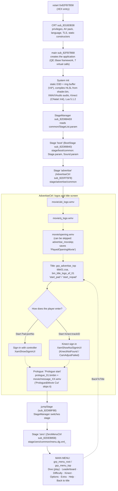

# Eden-Recomp — Boot flow up to the main menu (static analysis)

2026-11-19. **The game had not been run yet when this was written**: this comes from reading the recompiled code
(`work/project/generated`), the executable's strings and the disc data. Each box says where it comes from.
Solid = there is direct evidence (function or string). Dotted = inferred order, not confirmed at run time.

## Evidence
| Step | Evidence |
|---|---|
| Entry and CRT | `xstart` is a jump to `sub_8316DB38`, which calls `XexCheckExecutablePrivilege`, `XGetAVPack`, `XGetLanguage`, `KeTlsAlloc` and then `sub_82FB7B68` (the `main`) |
| Systems | imports `Vd*`, `XMACreateContext`, `XAudioRegisterRenderDriverClient`; strings `CNatal::Init:NuiInitialize`, `$Lua: Lua 5.1.2`; `shader.bin` is HLSL |
| Stages | `common/StageList.param` lists: boot, select, test, sample, zero, matrix, beauty, evolution, passion, journey, modelviewer, enemy, player, hope. Enum `Main::Layer::Boot::CStageTypeEnum` next to `advertise`/`modelviewer` |
| Advertise | contiguous strings in the PE: `game:/movie/ubi_logo.wmv`, `q_logo.wmv`, `opening.wmv`, `advertise_movskip`, `PlayedOpeningMovie Save`, `Start Kinect:trackID %d`, `Start Pad:portNo %d`, `Prologue start`, `CAdvertiseCtrl::pad sign in to control pad` |
| Menu | `ZeroMenuCtrl` strings: `grp_menu_root`, `grp_menu_top`, `grp_menu_leaderboard`, `grp_menu_difficulty`, `grp_menu_kinect`, `grp_menu_options`, `grp_menu_extra`, `grp_menu_help`, `zero_root_dive`, `zero_root_backtotitle` |

Function addresses: `lis/addi` xrefs to the strings (`tools/analysis/xref_strings.py`) and call tree
(`tools/analysis/call_tree.py`).

## What is NOT confirmed
- The **exact order** inside advertise (logos → opening → title → prologue): it comes from the order of the strings
  and the logic of the names, not from a trace. The video paths are in a data table; they could not be tied to a
  specific function.
- What exactly the `boot` stage does and at what point `Database.xmplr` and `shader.bin` are loaded.
- Between `main` and `StageManager` control passes through virtual calls (framework tasks): the path in between
  cannot be seen statically. It will be confirmed with traces once the game runs.

## What it implies for the port
To reach the menu the following are needed, in this order: kernel/filesystem → GPU (first frame) → **WMV player**
(three videos before the title; if they do not decode it must be possible to skip them) → controller input and sign-in
(`XamShowSigninUI`) → profile save (`PlayedOpeningMovie`) → audio. Kinect can be left as "not found".
