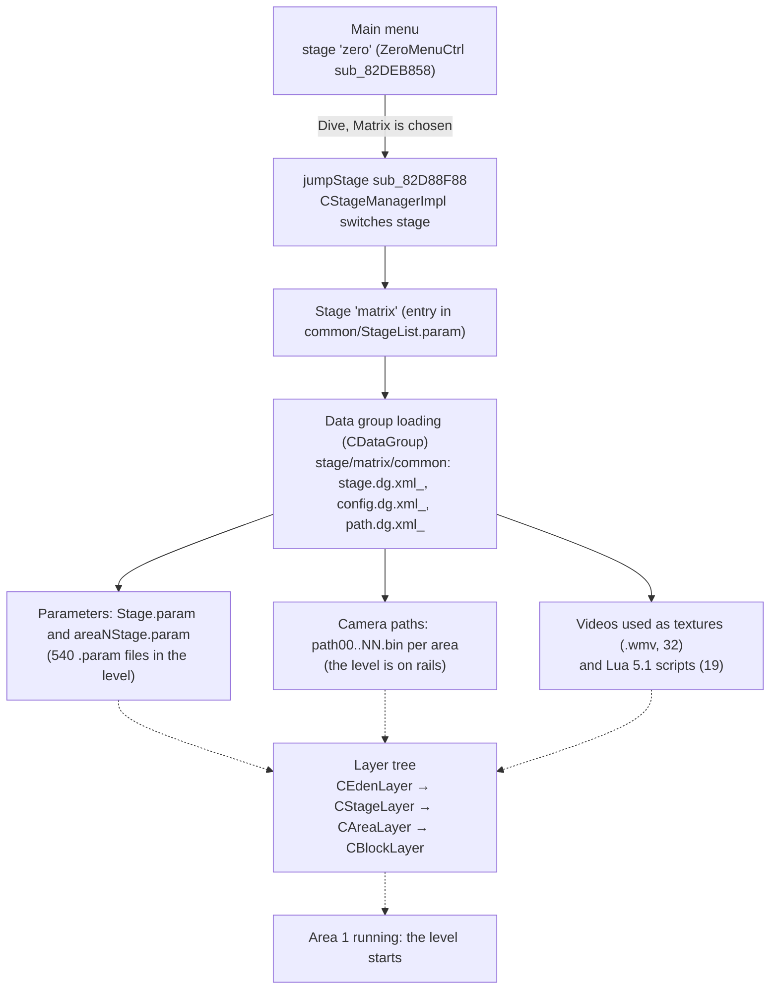
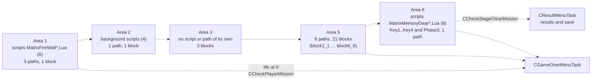
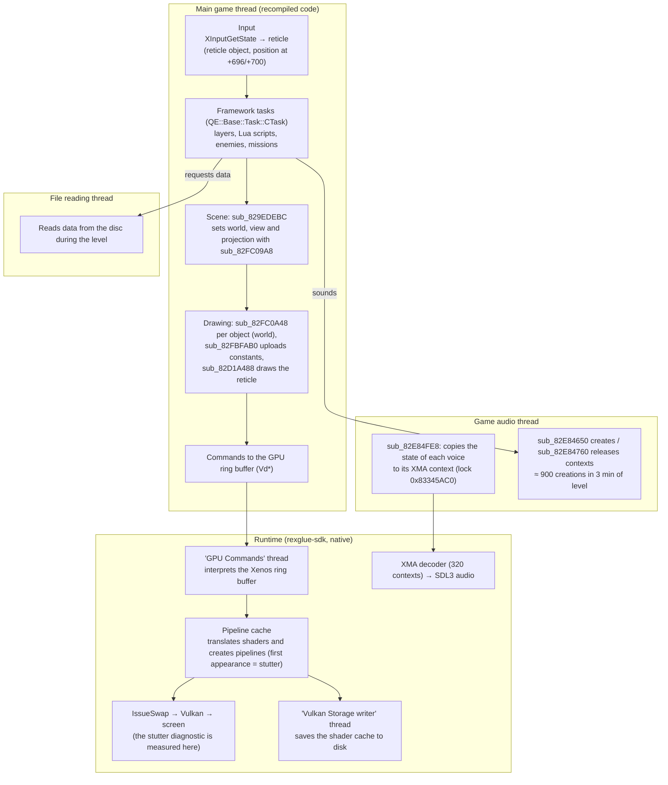
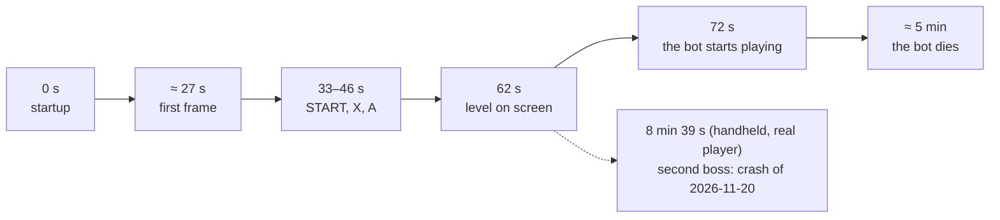

# Execution of the first level (Matrix): from the menu to the end of the level

2026-11-20. The goal was an execution diagram of the first level.
It brings together what is already measured in `docs/analysis/boot-flow.md`, `docs/analysis/vr-stage0.md` through
`vr-stage4.md`, `docs/analysis/xma-audio-crash.md` and the bot runs on the build machine, plus a new inventory of the
data under `stage/matrix/` and of the class names (RTTI) in the executable.

Marks: **[V]** seen in the code, the data or a log; **[I]** inferred; **[?]** undetermined.
In the diagrams, solid arrow = [V]; dotted arrow = [I].

## 1. From the menu to the level

| Step | Evidence |
|---|---|
| Menu and `jumpStage` | [V] `docs/analysis/boot-flow.md` (xrefs to the menu strings and to the stage switch) |
| `matrix` is a stage | [V] `common/StageList.param`: boot, select, test, sample, zero, **matrix**, beauty, evolution, passion, journey, modelviewer, enemy, player, hope |
| Data groups | [V] `stage/matrix/common/stage.dg.xml_` (XML with `<DataGroup>` and `<File … load="True/False">`), `path.dg.xml_` (13 paths: 3 for area 1, 1 for area 2, 8 for area 5, 1 for area 6) |
| Layers | [V] the classes `Main::Layer::CStageManagerImpl`, `CEdenLayer`, `CStageLayer`, `CAreaLayer`, `CBlockLayer` and `Main::Layer::Sequence::CAreaElementWork`, `CBlockElementWork` exist. [I] the nesting order comes from the names and from the data being laid out as `stage/<level>/area/<area>/block/<block>`; it has not been followed in the code |
| Path in execution | [V] run `run15`: `Return` (START) at 33 s, `X` at 40 s, `A` at 46 s, and the level is already visible at 62 s |

## 2. Structure of the level

- [V] The areas that exist on disc are **1, 2, 3, 5 and 6** (there is no area 4). Counts of scripts, paths and blocks:
  listing of `stage/matrix/area/`.
- [V] Area 1 carries the `MatrixFireWall` scripts (with variants `Worm`, `Uni`, `JF`, `Fcount`, `ParamLink`) and area 6
  the `MatrixMemoryGear` ones (four `Key`, `Phase3`, `Phase3_Worm`); the class `CGearMainUnit` exists in the
  executable.
- [I] The order 1 → 2 → 3 → 5 → 6 comes from the numbering. [I] That FireWall and MemoryGear are the bosses comes from
  their names and from their having phases; it has not been seen in execution which area corresponds to what the
  tester calls the "second boss".
- [V] `Main::Mission::CCheckPlayerMission`, `CCheckStageClearMission`, `Main::Menu::CGameOverMenuTask` and
  `CResultMenuTask` exist.
- Game over, from static analysis on 2026-11-20 (read in the listing, **not executed yet**): the player's life is an
  integer at `object+1332` (0..10000, 2000 per petal, starts at 6000); `sub_82D07F00` subtracts from it on a hit; when
  it reaches 0 the player sends message 5, `CCheckPlayerMission` (`sub_82D5AFD0`) emits 18, the level handler
  `sub_82D89E98` sets bit 0 of `+3548` and `sub_82D8A8D8` creates `CGameOverMenuTask` (`sub_82935538`). Message 19
  sets bit 1 (results). [?] Whether there is another game-over route that does not go through life.
- [?] Nobody has finished the level in the port: the bot dies around minute 5 and neither results nor a save have been
  seen.

## 3. One frame of the level: threads and who calls whom

| Piece | Evidence |
|---|---|
| Reticle | [V] `vr-stage4.md`: object with virtual table `0x8237F560`, position at `+696/+700`, drawing `sub_82D1A488` |
| Scene and matrices | [V] `vr-stage0.md` §1: `sub_82FC09A8` (26 calls) sets world/view/projection; `sub_82FC0A48` (228 calls) only the world; `vr-stage4.md`: the caller of the level's scene is `sub_829EDEBC` |
| Tasks | [V] `QE::Base::Task::CTask` exists. [I] that layers, scripts and enemies run as tasks in that order: the step between `main` and the `StageManager` goes through virtual calls and has not been traced |
| Audio | [V] `xma-audio-crash.md`: stack of the crash and counts from runs 300–302 |
| File reading | [V] a separate thread emits the `XFileSectorInformation` warnings (997 in one session on the handheld) |
| GPU and cache | [V] `GPU Commands` thread (a crash in it was fixed earlier), the SDK's `pipeline_cache.cpp`, log line `Created 152 graphics pipelines from Vulkan storage` |
| Kinect | [V] the Kinect thread exists (`vr-stage0.md` §2) but in controller mode it does not take part |

## 4. What was measured over time

- [V] 27 s to the first frame: `gpu-startup.md`. [V] 33–62 s: `run15`. [V] bot: `tools/test/run.sh <N> … b72-1260`.
- [V] 8 min 39 s: core dump `133834` from the handheld (XMA audio crash, already patched). [?] The new crash reported
  by the tester after that patch ("framerate at 30 and a crash after a challenge") has not been diagnosed: the
  handheld's logs are missing.
- Stutters measured in 2 min 46 s of level: 25 with the shader cache empty, 3 with the cache full (runs 303/304).

## 5. What this document does NOT claim
- The real order of the areas and where each boss falls (only inferred from names and numbers).
- The exact order of the tasks within a frame.
- Anything after minute 5 on the build machine: no run gets that far.
